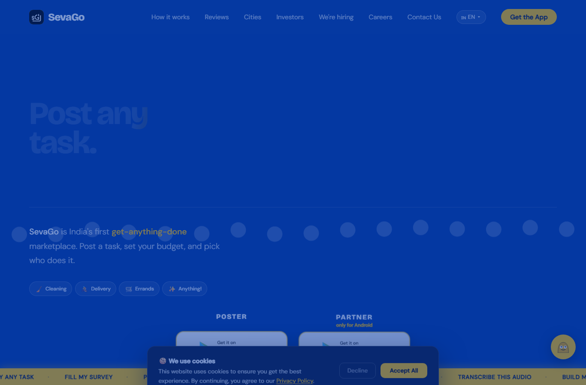
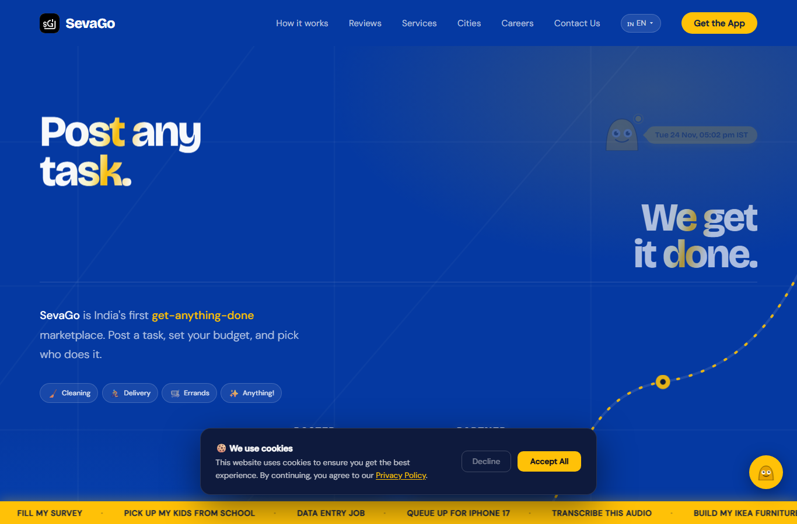
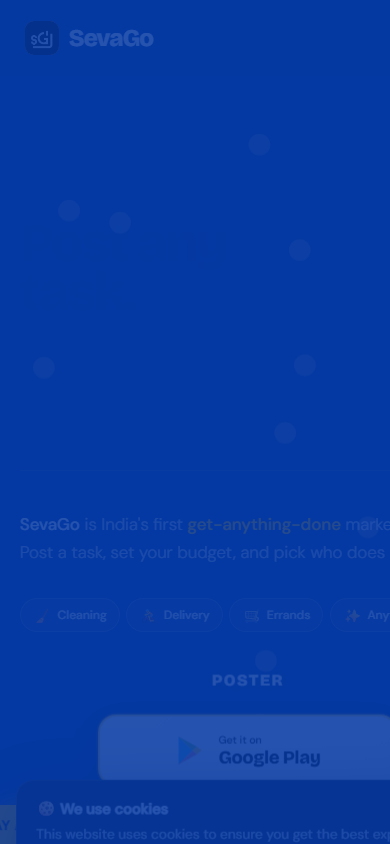
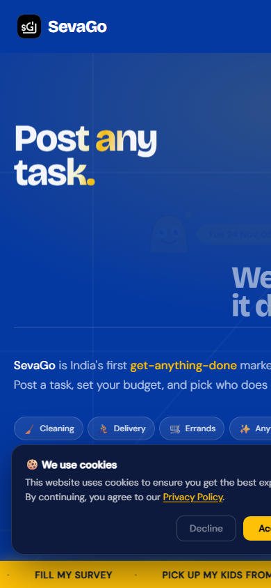
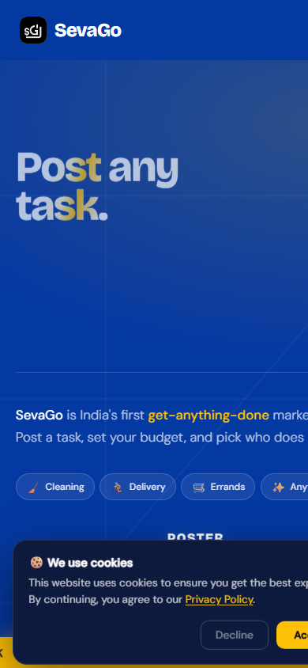
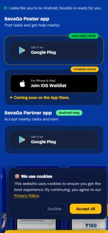
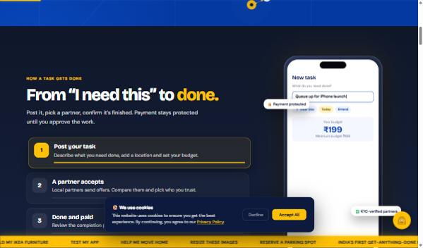
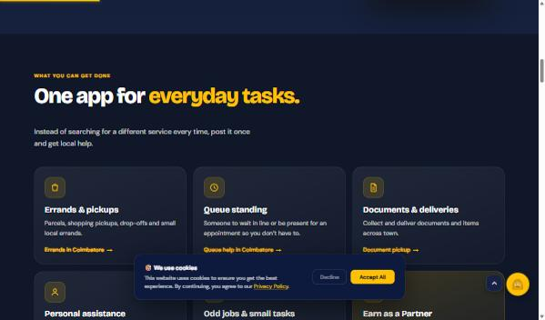
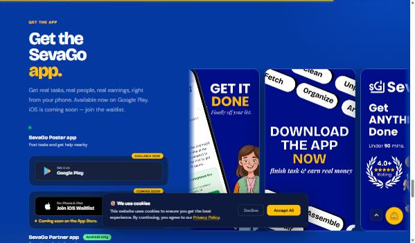

# Redesign notes, link audit and before/after

## Before / after

| | Before | After |
|---|---|---|
| Hero (desktop) |  |  |
| Hero (Android phone UA) |  |  |
| Hero (iPhone UA) | n/a |  |
| Download panel on a 375 px phone | n/a |  |
| Task journey (new) | n/a |  |
| Service cards (new) | n/a |  |
| Download panel | Play button only, iOS "Soon" placeholder |  |

The hero screenshots are headless-browser captures taken part-way through the entrance animation, so some hero text is still fading in. The three `.jpg` files are captures from the preview browser at 1366 px wide. The headless capture tool could not reliably capture below-the-fold sections, so those are preview-pane captures. I did not produce before-shots of the lower sections.

## Download link audit

Live Play listings, opened in a real browser 24 Nov 2026:

| App ID | Result | Listing title |
|---|---|---|
| `com.sevago.app` | **Live** | SevaGo: Errands & Local Help |
| `in.sevago.partner` | **Live** | SevaGo Partner |
| `com.app.initio.sevago` | **404 Not found** | (used by the site in 11 places) |

| Where | Was | Now |
|---|---|---|
| Nav "Get the App", mobile menu, exit popup, FAQ CTA, hero | dead listing | Poster app |
| Yellow **"Download App & post a task"** (How it works) | dead listing | Poster app; tasker tab now says "Get the Partner app & start earning" and opens the Partner app |
| Earnings "Download the app" | dead listing | Partner app |
| Hero Poster / Partner buttons | already correct | unchanged, now tracked |
| Privacy-policy text link to the dead listing | dead | removed with the old popup (legal text lives only on `/privacy` and `/terms`) |
| `/careers` and 404 page "Get the App" | dead listing | Poster app |
| `#hiring` links (nav, mobile menu, footer) | pointed to a section that no longer exists | removed duplicate; footer link now `/careers` |
| `careers.html` links | 404 (page moved to `/careers`) | `/careers` |
| `/careers` nav used relative `index.html#…` links | broke from inside `/careers/` | root-relative `/#…` |
| `index.html#investors` on 404 and `/careers` | removed section | links deleted |
| Old `privacy-policy.html` | linked to non-existent `/terms-of-service` | file deleted; `/privacy-policy` and `/terms-and-conditions` redirect to `/privacy` and `/terms` |
| iPhone / iPad visitors | Play button | every Poster CTA scrolls to and opens the **iOS waitlist** (or the App Store once configured). Partner links stay, with an "Android-only for now" note. |

`tests/seo.test.js` re-checks all of this on every run (every Play link must be one of the two live IDs; every internal link and `#anchor` must resolve).
**Not checked automatically:** Google blocks scripted requests to Play (HTTP 403 to curl), so listing health must be re-checked by hand after any Play Console change.

## What changed on the home page

- **Removed:** Investors section, nav/mobile/footer links, investor CSS, i18n keys, scroll-colour and keyboard-nav entries, and the FAQ wording about investor enquiries. `grep -i investor index.html` returns nothing (tested).
- **Hero:** random drifting dots replaced by a route graphic: a pin, a moving helper and a completed-task check (SVG, ~1.5 KB).
- **New "task journey" section:** three clickable steps (post → partner accepts → done and paid) beside a phone mockup built in HTML/CSS, with a looping step highlight that pauses once the visitor chooses a step or has reduced-motion on. Phone screens use details from the app's own screens (₹199 minimum budget, offers, completion photo, "I confirm completion").
- **New services section:** six interactive cards (cursor spotlight, lift, staggered entrance) that link to the Coimbatore landing pages. Categories come from the Play listing.
- **Download panel:** Poster group (Google Play + Apple-style **Join iOS Waitlist** button + "Coming soon on the App Store."), then Partner group with an "Android only" badge. Consistent widths, heights and spacing. iOS visitors see the waitlist first, Android visitors Play first.
- **Sticky mobile CTA** (≤768 px): "Get SevaGo on Google Play" (Android) or "Join the iOS waitlist" (iPhone), shown after the hero, hidden over the download panel and while typing.
- **Motion:** staggered entrances, hover lift on buttons/cards, floating phone, animated journey. All transform/opacity; everything stops under `prefers-reduced-motion`.
- **Performance:** images extracted to cached files with dimensions and lazy loading; removed the body fade-in that delayed first paint; hero canvas loop removed.
- **Not changed:** your copy, the careers/hiring flows, chat assistant, language switcher, reviews, cities, earnings, ambassador and FAQ sections, and the waitlist backend from PR #3.

## Known limits

- This is a restyle layered on the existing inline-CSS page, not a rebuild. The ~4,000 lines of legacy inline CSS/JS are untouched and remain the biggest INP risk.
- Visual design is my interpretation of "premium"; I had no design brief or brand guide. Review in the preview before deploying.
- Not tested on a physical iPhone or Android device; detection was verified with real iPhone and Android user-agent strings in headless Edge, and the layout in a 375 px emulated viewport.
- The local test server does not run Vercel functions or `/_vercel/insights`, so two console errors (`404` on insights, `501` on `/api/track`) appear locally only.
